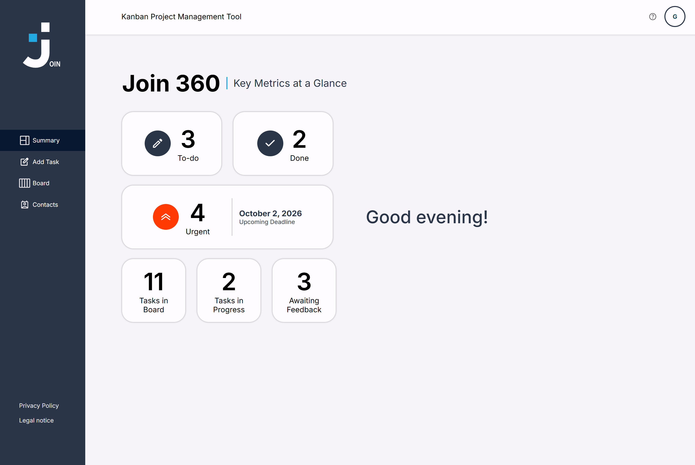

# Join – Kanban Project Management Tool 📋

Join is a Kanban-style project management tool, built as a group project in the Developer Akademie Fullstack course with plain HTML, CSS and JavaScript (no framework, no build tools) and Firebase as backend.

## Preview




## Features

- **Login and sign up** with Firebase Authentication, including a guest login
- **Summary** with task counts per phase, the next urgent deadline and a time-dependent greeting
- **Board** with four columns (To do, In progress, Await feedback, Done), search, drag and drop and a hint for empty columns
- **Tasks**: add, view, edit and delete tasks with title, description, due date, priority, category, assigned contacts and subtasks
- **Subtasks**: add, edit and delete, with the completion shown as a progress bar on the task card
- **Contacts**: add, edit and delete contacts, each with its own colour and initials; deleting a contact also removes it from all tasks
- **Responsive** layout from 320 px, with a hint to rotate the device on phones in landscape mode
- **Legal notice, privacy policy and help page**

## Project Structure

```
join/
├── index.html                  # Login page
├── script.js                   # Shared logic for most pages (user menu, logout)
├── style.css                   # Global styles (reset, layout, sidebar)
├── html/                       # All other pages
│   ├── signup.html             # Sign up
│   ├── summary.html            # Summary (dashboard)
│   ├── board.html              # Kanban board
│   ├── add-task.html           # Add task
│   ├── contacts.html           # Contacts
│   ├── help.html               # Help
│   ├── legal-notice*.html      # Legal notice (logged in and external)
│   └── privacy-policy*.html    # Privacy policy (logged in and external)
├── js/
│   ├── firebase-config.js      # Firebase initialisation
│   ├── auth.js                 # Login, guest login and sign up
│   ├── auth-check.js           # Redirects to the login if nobody is logged in, shows the initials
│   ├── db.js                   # Database access for the board and the task form
│   ├── board.js                # Board and task dialogs
│   ├── move-tasks.js           # Drag and drop of tasks between columns
│   ├── task-form.js            # Task form (validation and saving)
│   ├── assigned-to.js          # Assigned contacts dropdown of the task form
│   ├── category-select.js      # Category dropdown of the task form
│   ├── subtasks.js             # Subtask logic of the task form
│   ├── subtask-templates.js    # HTML templates for subtasks
│   ├── templates.js            # HTML templates for tasks and the task form
│   ├── html-utils.js           # Escapes special characters in HTML
│   ├── search.js               # Search for tasks and contacts
│   ├── summary.js              # Summary figures and greeting
│   ├── contact.js              # Contact list and details
│   ├── contact-dialog.js       # Add and edit contact dialog
│   ├── contact-templates.js    # HTML templates for contacts
│   ├── contact-utils.js        # Validation and helpers for contacts
│   ├── toast.js                # Toast messages
│   └── add-task.js             # Entry point of the add task page
├── styles/                     # CSS, one file per area (variables.css holds the colours)
└── assets/                     # Fonts, icons and images
```

## Tech Stack

- HTML5, CSS3 and vanilla JavaScript (ES modules)
- Multi-page application
- Firebase Authentication and Firebase Realtime Database
- JSDoc for code documentation
- Git and GitHub for version control

## Team

- Micha Gut
- Robert van den Boom

## Quick Start

1. Clone the repository:

```bash
git clone https://github.com/MichaGutDev/join-3236.git
cd join
```

2. Start a local web server and open `index.html`, for example with the Live Server extension in VS Code. Opening the files directly from the file system does not work because the scripts are ES modules.
3. The Firebase connection is configured in `js/firebase-config.js`. To use your own Firebase project, replace the values there and enable Email/Password and Anonymous sign-in in Firebase Authentication.

## How It Works (Overview)

- Almost every page loads `script.js` for the user menu and logout (only the two external legal pages do not). Pages that need a login also load `js/auth-check.js`, which sends visitors without a session back to `index.html` and shows the initials of the user in the header.
- `js/auth.js` handles login, guest login and sign up. A new user also gets an entry in the contact list.
- `js/db.js` reads, saves and deletes tasks and contacts for the board and the task form. The contact list, the summary, the sign up and the login check use the Realtime Database directly in their own files. The board, the summary and the contact list listen to the data and update themselves when it changes.
- `js/board.js` renders the four columns and opens the task dialogs (view, add, edit), `js/move-tasks.js` moves tasks by drag and drop. The task dialog uses the form from `js/task-form.js`, which also runs on the add task page. The subtasks, the assigned contacts and the category are handled in their own modules (`js/subtasks.js`, `js/assigned-to.js`, `js/category-select.js`).
- HTML for tasks, forms, subtasks and contacts is created in the template files (`templates.js`, `subtask-templates.js`, `contact-templates.js`), so the logic files stay mostly free of markup.
- The main colours are defined as variables in `styles/variables.css`. Each area has its own CSS file, loaded on the pages that need it.

## License

> [!NOTE]
> This is a learning project from the Developer Akademie Fullstack course. Assets such as icons, fonts and images may be subject to their own licenses.
